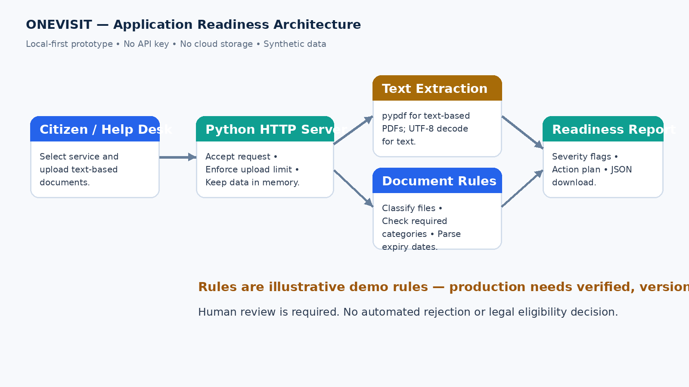
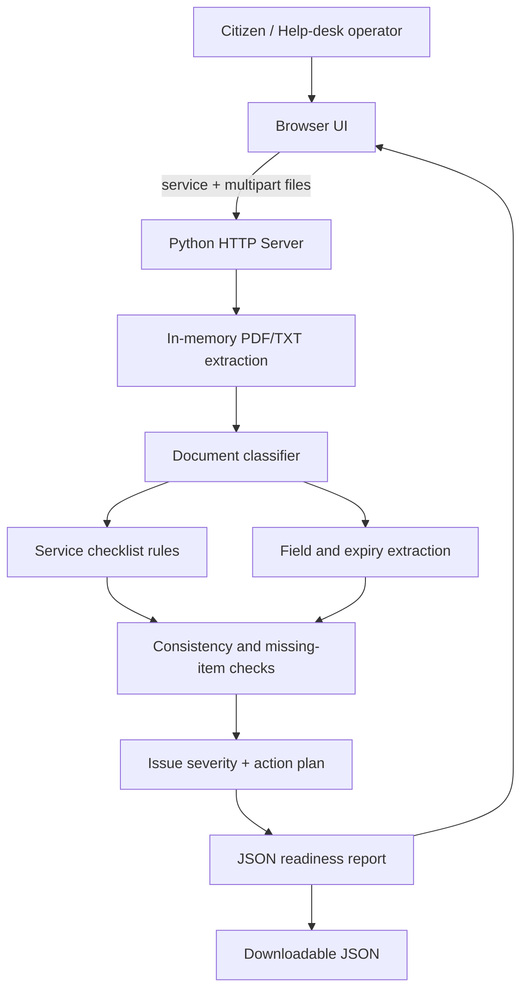

# ONEVISIT Technical Design

## 1. System overview

ONEVISIT is a local-first, single-user web prototype. The browser hosts the user interface; a small Python HTTP server receives a service selection and uploaded files; the document engine extracts text and runs explicit, explainable checks; the browser renders a structured report. There is no third-party API call and no persistent document store.

## 2. Architecture

The same flow is available as Mermaid source below for editing.

## 3. Request lifecycle

1. User selects one service profile.
2. User uploads one or more PDF/TXT/CSV/MD files.
3. Server enforces a request-size limit and accepts only supported file extensions.
4. PDF text is extracted with `pypdf`; text formats are decoded as UTF-8.
5. Each document is classified using filename and content keywords.
6. The engine extracts selected fields such as applicant name and an explicitly stated validity date.
7. It checks document categories required by the selected demonstration profile, explicit expiry, and possible name variation across documents.
8. It calculates a simple severity-based score, creates recommended actions and returns JSON.
9. The browser renders the findings and offers a JSON report download.

## 4. Data model

### Input document (in-memory)
| Field | Type | Description |
|---|---|---|
| `filename` | string | Sanitized display filename; not used as an identity claim. |
| `text` | string | Extracted text, held in memory for the current request. |

### Inspected document
| Field | Type | Description |
|---|---|---|
| `filename` | string | Uploaded filename. |
| `type` | enum-like string | `identity`, `income`, `bank`, `student`, `age`, `address`, `marksheet`, `transfer` or `unknown`. |
| `name` | string/null | Name extracted from recognized text labels. |
| `expiry_date` | string/null | Explicit validity date, if found. |
| `flags` | array | Issues needing review. |
| `status` | string | `Readable` or `Needs manual review`. |

### Readiness report
| Field | Type | Description |
|---|---|---|
| `service` | string | Selected demo service. |
| `documents` | array | Inspected-document records. |
| `missing` | array | Missing required document categories. |
| `issues` | array | Severity, document and human-readable message. |
| `score` | integer | Heuristic score from 0 to 100. |
| `readiness` | string | Human-readable status. |
| `actions` | array | Suggested applicant next steps. |
| `disclaimer` | string | Mandatory limitations statement. |

## 5. Rule logic

The service profile specifies required document categories. Missing categories receive high-severity flags. A date is flagged only when an explicit validity field can be parsed and is earlier than the machine's current date. Names are normalized to alphabetic characters and compared using sequence similarity; a low similarity ratio creates a medium-severity review flag. These checks never automatically reject a person or modify an official document.

The readiness score is:
`max(0, 100 - 25 × high_severity_count - 10 × medium_severity_count)`.
It is a prototype prioritization aid, not a calibrated confidence or approval probability.

## 6. Security and privacy

- Uploaded bytes are processed in memory and not deliberately written to disk.
- A configurable maximum request size is enforced.
- Only text-based PDF/TXT/CSV/MD input is accepted by the UI.
- The local server binds to `127.0.0.1` by default.
- This MVP has no authentication or encryption layer and is not suitable for public deployment.
- Production design must add consent, data minimization, access controls, encrypted transport/storage, retention and deletion policies, auditability, abuse protection and a privacy impact assessment.

## 7. Production deployment gates

Before field use, replace example checklists with verified rule packs. Each rule must include issuing authority, official source URL, jurisdiction, effective date, last verification date and version. Provide a human appeal/correction process; accessibility and regional-language reviews; security testing; and a pilot with measurable baseline and post-deployment outcomes.
